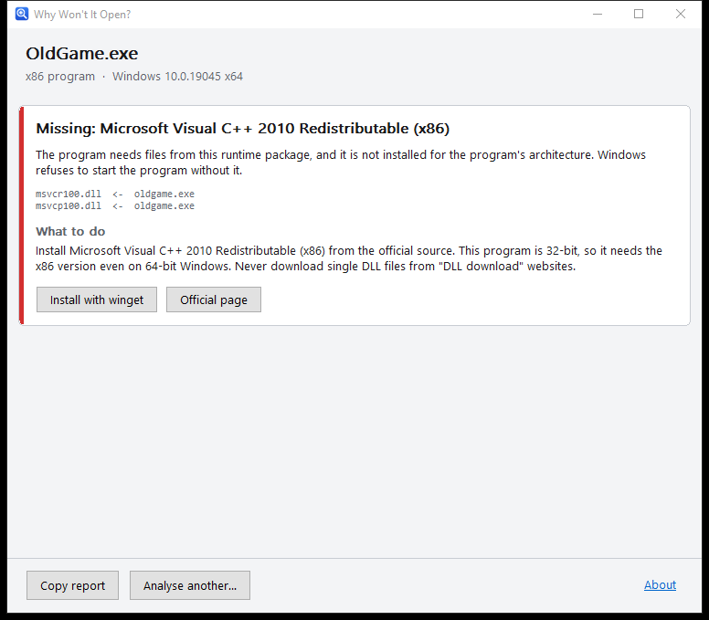

# Why Won't It Open? (Neden Açılmıyor?)

[](https://github.com/nowackk-cp/why-wont-it-open/actions/workflows/build.yml)
[](https://github.com/nowackk-cp/why-wont-it-open/actions/workflows/links.yml)
[](LICENSE)

A Windows program doctor. Drag an `.exe` that refuses to start onto the window, and it tells you
**which component is missing or wrong** and points you to the **official** fix.



> "The code execution cannot proceed because MSVCP140.dll was not found."
> "The application was unable to start correctly (0xc000007b)."
> "The procedure entry point … could not be located in the dynamic link library …"

Instead of downloading random DLLs from shady websites, find out what is actually wrong.

## Download

Get `WhyWontItOpen-<version>-x86.exe` from the [latest release](https://github.com/nowackk-cp/why-wont-it-open/releases/latest).
It is a single file with no installation. It runs on 32- and 64-bit Windows 10 and 11 (Windows 7 and 8.1 should work but are not tested).

Every release is built on GitHub Actions with a signed build-provenance attestation. To verify a download:

```bash
gh attestation verify WhyWontItOpen-<version>-x86.exe --repo nowackk-cp/why-wont-it-open
```

## Principles

- **Never runs the program it inspects.** Files are only read and parsed; DLLs are never loaded
  with `LoadLibrary`, so even a malicious file cannot execute code.
- **Sends nothing anywhere.** No telemetry, no uploads. The only network access is when *you* click
  an install button.
- **Portable.** A single x86 `.exe`, statically linked against the C runtime, so it starts even on
  a machine missing the very runtimes it diagnoses.
- **Honest.** When the tool isn't sure, it says so. A wrong diagnosis is worse than none.
- **Official fixes only.** Installs go through `winget`, or through a download from an allow-listed
  vendor host whose Authenticode signature must be valid **and** match the expected publisher.
  Nothing unsigned is ever executed. The tool itself never asks for administrator rights.

## What it detects

| Problem | Example | Fix it points to |
|---|---|---|
| Missing runtime DLL | `MSVCP140.dll was not found` | The right Visual C++ / DirectX / XNA / PhysX package **for the program's architecture** |
| 32/64-bit mix-up | `0xc000007b` | The wrong-architecture copy (program folder, `PATH`, or System32/SysWOW64) |
| Outdated DLL | `entry point … could not be located` | Old copy shadowing a newer one, or an outdated runtime |
| Debug build shipped by mistake | `VCRUNTIME140D.dll`, `ucrtbased.dll` | Ask the developer — these must never be downloaded |
| Platform mismatch | 64-bit program on 32-bit Windows, ARM64 program on x64 | Get the right edition |
| Damaged / incomplete file | interrupted download, archive renamed to `.exe`, 16-bit program | Re-download, extract, use DOSBox |
| .NET Framework 3.5 | program built for CLR 2.0 | Turn on the Windows feature |
| .NET 5+ runtime | `runtimeconfig.json` asks for a missing Desktop Runtime | The exact .NET runtime and architecture |
| Program's own files | `steam_api64.dll`, Qt, SDL, Bink … | Verify / reinstall — no DRM bypassing, ever |
| Graphics driver components | `vulkan-1.dll`, `nvcuda.dll` | Update the graphics driver |
| Packed executables | high entropy, almost no imports | Says the analysis is limited instead of guessing |

The resolver imitates the Windows loader: KnownDLLs, API sets (read from the live API set schema),
application folder, System32 / SysWOW64 with WOW64 redirection, Windows folder, `PATH`, WinSxS
side-by-side assemblies (Common Controls 6, VC++ 2005/2008) and private assembly folders
(as used by Chrome or Blender). It walks the dependency tree of the program and of
redistributable runtimes, but not of Windows' own DLLs.

## Command line

```bash
neden check game.exe                # human-readable report (English or Turkish, follows Windows)
neden check game.exe --json         # machine-readable
neden check game.exe --lang tr
neden fix game.exe                  # install the official fixes, asking before each one
neden info game.exe --verbose       # what the PE file contains
```

`check` exits with 0 when no problem was found, 3 when problems were found and 2 when the file
could not be analysed.

Optional Explorer right-click entry for `.exe` and `.dll` files (per user, no admin rights):

```bash
WhyWontItOpen.exe --register-shell
WhyWontItOpen.exe --unregister-shell
```

## Building

Requires Visual Studio 2022 or newer (Desktop development with C++) and CMake ≥ 3.21.

```bash
cmake --preset x86
cmake --build --preset x86-release
ctest --preset x86-release
```

Outputs: `build/x86/gui/Release/WhyWontItOpen.exe` and `build/x86/cli/Release/neden.exe`.

Layout:

```
core/       library with all the logic, no UI
  pe/         bounds-checked PE parser (headers, imports, delay imports, exports, CLR, manifest)
  resolve/    loader search order, API sets, WOW64, SxS
  env/        file system / registry / OS behind an interface (FakeEnvironment for tests)
  kb/         JSON parser + embedded data/runtimes.json
  diagnose/   rules -> findings (English and Turkish)
  fix/        winget, allow-listed download, Authenticode verification
cli/        neden.exe
gui/        WhyWontItOpen.exe (pure Win32, per-monitor DPI, screen-reader friendly)
data/       runtimes.json knowledge base
tests/      unit, end-to-end (simulated machines) and integration tests (real MSVC-built binaries)
fuzz/       libFuzzer target for the PE parser (runs in CI)
```

Because CI runners have every runtime installed, the diagnosis is tested against a simulated
machine (`neden::env::FakeEnvironment`) — e.g. "a 64-bit Windows 7 with VC++ x64 but not x86".

## Contributing

The easiest way to help is adding a DLL → package mapping to
[`data/runtimes.json`](data/runtimes.json) — see [CONTRIBUTING.md](CONTRIBUTING.md).
Links are checked weekly by CI.

## Türkçe

**Neden Açılmıyor?**, açılmayan Windows programlarını teşhis eden ücretsiz ve açık kaynak bir araçtır.
Açılmayan `.exe`'yi pencereye sürüklersiniz; araç eksik ya da yanlış bileşeni bulur ve **resmi**
çözümü gösterir.

- "MSVCP140.dll bulunamadı", "0xc000007b", "giriş noktası bulunamadı" gibi hataların gerçek
  sebebini bulur.
- Hedef programı **asla çalıştırmaz**, sadece dosyayı okur.
- Dışarıya **hiçbir veri göndermez**.
- Kurulum gerektirmeyen **tek bir exe**'dir; 32 ve 64-bit Windows 10 ve 11'de çalışır.
- Çözümü tek tıkla kurabilir: `winget` ile ya da imzası doğrulanmış resmi Microsoft/NVIDIA
  kurulum dosyasıyla. İmzasız hiçbir şey çalıştırılmaz.
- Arayüz Windows Türkçeyse otomatik olarak Türkçe açılır. "Raporu kopyala" butonu, forumlara
  yapıştırılabilecek bir rapor üretir.

**Lütfen DLL dosyalarını "DLL indirme" sitelerinden indirmeyin.** Yanlış mimaride ya da eski
sürümde olurlar, çoğu zaman sorunu büyütürler ve zararlı olabilirler.

Katkı vermek için en kolay yol `data/runtimes.json` dosyasına yeni bir DLL eşlemesi eklemektir
(bkz. [CONTRIBUTING.md](CONTRIBUTING.md)). Sorun bildirimleri Türkçe de yazılabilir.

## License

[MIT](LICENSE)
